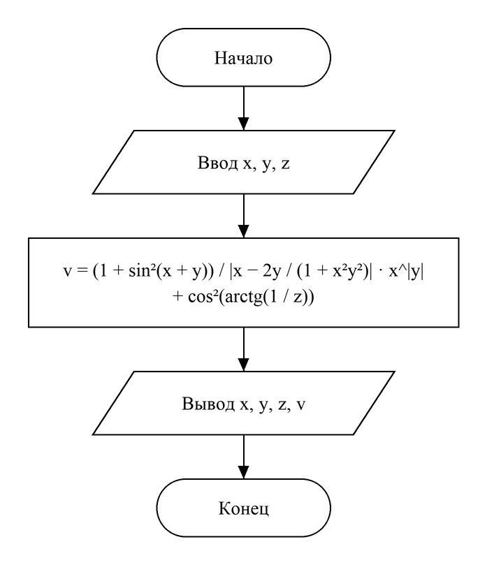

# Домашнее задание к работе №5
Вариант 3

## Условие задачи
Создать программу вычисления указанной величины. Результат проверить при заданных исходных значениях.

$$v = \frac{1 + \sin^2(x + y)}{\left|x - \frac{2y}{1 + x^2 y^2}\right|}\, x^{|y|} + \cos^2\left(\mathrm{arctg}\,\frac{1}{z}\right)$$

Контрольный пример: при x = 3.74·10⁻², y = −0.825, z = 0.16·10² результат **1.0553**.

## 1. Алгоритм и блок-схема
### Алгоритм:
1. Начало.
2. Объявить вещественные переменные **x, y, z** — исходные данные и **v** — результат.
3. Ввести x, y, z.
4. Вычислить **v** по формуле с помощью функций из math.h: **sin, cos, atan** (арктангенс), **fabs** (модуль), **pow** (степень). Квадраты sin и cos записываются как pow(…, 2).
5. Вывести исходные данные и v с точностью 4 знака после запятой, как в контрольном примере.
6. Конец.

### Блок-схема:


## 2. Реализация программы
```c
#define _CRT_SECURE_NO_DEPRECATE
#define _USE_MATH_DEFINES
#include <stdio.h>
#include <locale.h>
#include <math.h>

// Вариант 3
// v = (1 + sin^2(x + y)) / |x - 2y / (1 + x^2 * y^2)| * x^|y| + cos^2(arctg(1 / z))
// Контрольный пример: x = 3.74e-2, y = -0.825, z = 0.16e2, v = 1.0553
int main() {
    setlocale(LC_CTYPE, "RUS");
    double x, y, z, v;
    printf("Введите x, y, z через пробел: ");
    scanf("%lf %lf %lf", &x, &y, &z);
    v = (1 + pow(sin(x + y), 2)) / fabs(x - 2 * y / (1 + x * x * y * y)) * pow(x, fabs(y))
        + pow(cos(atan(1 / z)), 2);
    printf("x = %g, y = %g, z = %g\n", x, y, z);
    printf("v = %.4f\n", v);
    return 0;
}
```

## 3. Результаты работы программы
Случай 1:
```
Введите x, y, z через пробел: 3.74e-2 -0.825 0.16e2
x = 0.0374, y = -0.825, z = 16
v = 1.0553
```
Случай 2:
```
Введите x, y, z через пробел: 2 1.5 0.3
x = 2, y = 1.5, z = 0.3
v = 1.9511
```

## 4. Информация о разработчике
Головкова Милена Евгеньевна, бТИИ-261
